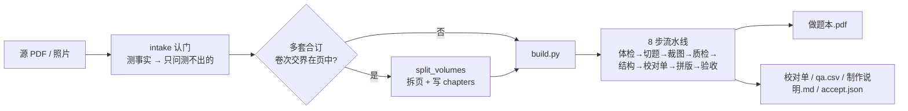

# 工作原理：一份 PDF 怎么变成做题本

> 写给想改这个仓库、或想判断「我这本书能不能做」的人。
> 本文只讲机制与设计取舍；命令与参数见 [README](README.md) 和 [使用手册](references/user-guide.md)。
> 文中数字都来自真书实测，不是估算。

## 一句话

**把每道题当成一张图从原书裁下来，只重新分配留白和页面骨架。**

不 OCR 转写、不重排公式、不改字形。成品里看到的每个字、每条分数线、每个矩阵都是原书那张图；
重新画的只有页眉、章节页、目录、页码、题与题之间的空白，以及一层**看不见**的可搜索文字。

原书的排版本身就是最好的排版。位图路线零信息损失、可批量、可自检；代价是清晰度上限由输入分辨率决定。

注意「不 OCR 转写」不等于「不用 OCR」：OCR 在扫描件路线里是主力，只是拿它当眼睛、不当笔，见下一节。

## 和 agent 的分工：可进化，但不穷举预案

这个 skill 跑在 agent 上，**不需要把所有版式都预先写进 `profiles/`**。
真把每类书的判据、阈值、正则都装齐了，也就不需要 agent 了。

- 脚本负责确定性判据、可复用的坑表结构，以及**如实报告「我没覆盖到」**
  （`probe` 的 NO-GO、`expect` 的「未覆盖」、`accept.json` 的 `warnings`）。
- agent 负责读懂没写过的版式、临时补配置、判断这次的经验值不值得沉淀，
  并在交付时把「要不要改 skill」交给用户选。
- 个案留在个案里：页段、章名、页眉、条带几何只写进这本书的 `intake.yaml`；
  `learn.py` 沉淀前先问「下本同类书也会这样吗」，答不上来就先 `--dry`。

所以「这次没写进预案」不是缺陷；为了「让闸全绿」去放宽阈值、
或把一本书的数值固化成通用配置，才是把方向搞反了。

## 为什么不重排

| | 位图裁切（默认） | 矢量重排（`reflow.py`） |
| --- | --- | --- |
| 题干来源 | 原书渲染的位图 | 多模态模型逐题转 LaTeX |
| 错误模式 | 切歪了**看得出来** | 识别错了但**看起来完全正常** |
| 单位成本 | 整本几秒到几分钟 | 每题 30–60 秒（读图 + 转写 + 核对） |
| 版式 | 原书复刻 | 换成宋体 + Computer Modern |

通用 OCR 走不通，因为公式是二维嵌套结构，把「中文 + 行内公式」的混排行当一维文本处理会整句蒸发：

```
原文  设曲面 Σ: |x|+|y|+|z|=1，则 ∬_Σ (x+|y|)dS = ____
OCR   设曲面:++=，则(x+)ds =
```

原文有文字层的 PDF 更不该转写——源头本来就是矢量，转写等于凭空引入识别错误，把渲染 dpi 提到 400 就够了。
只有「分辨率撑不住打印」才值得走矢量，而且必须逐题对照原图核对，`uncertain` 字段是必填项。
这条路**由 agent 驱动，不是流水线自动分支**：脚本只负责生成 `items.json` 模板
（`vector_plan.py`，复用位图流水线裁出的题图），逐题转写和核对由 agent 完成，再交给 `reflow.py` 排版。
认门卡片上的两个选项带预估时间，量的是**从上传到交付的整轮**：位图是
「agent 判读 / 校对 / 可能的重跑 5–10 分钟 + 页数 × 两遍 OCR」，矢量是
「题数 × 30–60 秒 + 排版与校对」。脚本执行只占零头——实测一次构建 3.6 秒，
一轮「改 → 看」却要 5–10 分钟。两个时间都是粗估区间，不承诺精确时长。

## OCR 用在哪：当眼睛，不当笔

用了，而且扫描件路线全靠它。引擎是 `rapidocr-onnxruntime`（离线、无需 tesseract），
识别结果按页缓存进 `out/ocr/`，重跑只处理新增页。

| 环节 | OCR 做什么 | 只要认对什么 |
| --- | --- | --- |
| `segment_ocr.py` 左栏条带 | x 40–175pt、300dpi 单独识别**题号** | 那几个数字 |
| `segment_ocr.py` 横带 / 页眉 / 页脚 | 「一、选择题」「※命题点」、书名投票、页码 | 标题级，可跨页投票 |
| `segment_ocr.py` 夹缝补漏 | 题号序列有缺口时，400/600dpi 重识别夹缝 | 一个号码 |
| `crop.py` 文字层 | 纯扫描件整页 OCR（200dpi），供不可见文字层检索 | 认错不影响题面 |
| `photo_pipeline.py` | 照片放大 1.5× 并调高灵敏度（`box_thresh=0.3, text_score=0.3`） | 单页召回 8/9 → 9/9 |
| `split_volumes.py` | 目录是图片时，整页 OCR 找卷级标题 | 卷名 |

**界线在这里**：OCR 的输出只用于**定位**（题号在哪、哪一页换了章、切点落在哪）和**检索**
（那层看不见的文字）。题干始终以原书位图显示，屏幕上不会出现 OCR 认出来的字，
所以 `f(x)` 被认成 `f(α)` 不影响做题，只影响搜索和复制。

`probe.classify_text_layer` 还会反过来判「PDF 里那层能选中的字是不是后加的 OCR 层」：
是的话连题号都不从它读，改走条带 OCR——能选中不等于可信。

唯一不做的是**把题干 OCR 成文本再重新排版**，原因就是上一节那张公式对照。

## 总览



`build.py` 的步骤顺序是固定的：每一步的产物是下一步的输入，跳一步后面必炸。
`probe.py` 判 NO-GO 时会真的停下来——在错的版面上切，切点算法再准也只是「切得很整齐」。

## 0 认门：先测，再只问测不出来的

`scripts/intake.py` 只做两件事，顺序不能反：

**测**（全从文件里读，一句不问）：页数、文字层三态、单双栏、扫描件有效 dpi、题号正则命中率。
用户答的往往不如测的准。

文字层是**三态**，不是有/没有。中间那态最危险：扫描件后面加的 OCR 层也能选中、能搜，
但坐标是认出来的、字可能认错，只有把题号排成一列才发现整册错位。

| 状态 | 判据（`probe.classify_text_layer`） | 走哪条 |
| --- | --- | --- |
| `ok` 原生 | 每页字数够、文字块不碎 | `segment.py`，直接读文字坐标 |
| `ocr` 后加的 | 整页图占比 ≥0.75；或 ≥0.5 且块 ≤6 字；或块 ≤3 字 + 字体 ≤2 种 | `segment_ocr.py` |
| `none` 纯扫描件 | 每页 <80 字 | `segment_ocr.py` |

**问**：只问测不出来、又真正改变成品形态的，最多三个，每个带默认值——范围、每页题数、
纸型/制作方式。转述必须交成可点的选项卡片，而不是把选项抄成一段文字让人回一句。
产物是 `intake.yaml` 和一份回执；做书阶段**只准改这一份配置，不许动 `scripts/`**。

## 1 八道工序

| # | 脚本 | 做什么 | 为什么不能省 |
| --- | --- | --- | --- |
| 1 | `probe.py` | 体检：文字层、双栏、题号命中率、页眉页脚 | 双栏 / 正则不命中 / 页码越界，绕不过去 |
| 2 | `segment.py` / `segment_ocr.py` | 认题号 → `questions.json`（章、页、矩形、跨页标记） | 题号错比切点错致命：每张图看着都好 |
| 3 | `crop.py` | 按矩形裁成 300dpi 二值图；顺便收集文字层坐标 | 宽高由它写回题库，`layout` 才知道图多大 |
| 4 | `qa.py` | 切点质检 → `qa.csv` + 联系表 | 数字先判「哪几刀可疑」，不用点开 88 张图 |
| 5 | `structural.py` + `expect.py` | 编号跳号/重号/乱序 + **应有题数对账** | 只看图看不出少了一整节 |
| 6 | `review.py` | 校对单（按风险排序：红框 / 黄框 / 灰框） | 全自动切题一定有百分之一二出错 |
| 7 | `layout.py` | 拼版、章节页、目录、书签、页码、不可见文字层 | — |
| 8 | `accept.py` | 把成品读回来按读者视角验 | 排版代码只知道画了什么，不知道画出来像不像 |
| + | `report.py` | `制作说明.md`：判断 / 默认 / 没验到 | 换台机器、隔半年还能复盘 |

## 2 切点怎么定（最难的一步）

**题号的文字框顶不等于题目的上边缘。** 紧跟题号的大分式、积分号、矩阵、分段函数的大括号
会向上顶出十几到二十几 pt。直接拿文字框 y 当边界，下一题顶上的公式就被削一条，
留在上一题底部变成残渣。

两条路线都把边界吸附到原书的**整行空白带**上，但「什么是空白」不一样：

**文字层路线**（`common.build_questions`）
1. `ink_blocks()` 按行切墨块：**整行纯白**才算空（有一个墨点就是墨）。
2. `merge_slivers()` 把薄片并进相邻整行——∑ 上方那个 ∞ 只有 3pt 高，不并进去，
   切点就会落进 3pt 的缝里，上一题挂着 ∞、下一题的 ∑ 少上限。
3. 在窗口 `[y-34, y+4]` 里取**最靠下**的空白带中心当切点；取最靠下而不是最宽，
   因为题内行距可能比题间距还宽。
4. 封顶按**墨块顶**，不按文字框顶。

**扫描件路线**（`segment_ocr.py`）
- 左边栏条带（默认 x 40–175pt，300dpi）单独 OCR 找题号：整页 OCR 在题号紧跟大公式时会把题号吞掉。
- 一页**零题号**时自动向左加宽 16pt 重试（题号印到条带外，实测一页 19 题就这么没的）。
- 空白带用 `ink=2`（扫描件有噪点，一个墨点不算墨），候选宽 ≥4pt，页首硬切 `cut >= prev_y1 + 2`。

**反复踩过的同一类坑**：`ignore_patterns`、`SEC_RE`、8pt 门槛都是「语义层排除 ≠ 几何层不存在」。
被过滤掉的行如果还占着位置，边界计算照样把它框进题图——水印右半截、章节标题、
空续片、题 1 图里重复印的卷名，四次都栽在这上面。新增一条「这行不算正文」的规则时，
必须同时回答：它的墨会不会还在某个 rect 里？

**跨页续接**：解答题写不下接下一页时，页首那段按墨判（不按文字框）归给上一题；
章节标题落在页首带中间就在它两侧裁开，裁空即丢（8pt 净高门槛吃掉空带）。

## 3 四种输入，加一种输入侧预处理

| 输入 | 判据 | 预处理 |
| --- | --- | --- |
| 原生文字层 PDF | `text_layer: ok` | 无，正则直接读坐标 |
| 扫描件 + OCR 文字层 | `text_layer: ocr` | 无，但**不读那层坐标** |
| 纯扫描件 | `text_layer: none` | 条带 OCR 找题号 |
| 手机照片 | jpg/png | 光照归一化 → 去斜 → 白场校正，三步缺一不可 |
| 多套合订、卷次交界在页中 | 同页出现卷级标题且**标题上方还有 ≥3 行正文** | `split_volumes.py` 拆页 |

合订卷是输入侧的账：每套题号都从 1 重排，`chapters` 按整页盖章，两个页段必然重叠，
题号「22→1」会被判往回走（实测 88 题的书只切出 40 题）。`split_volumes.py` 从目录页去掉公共书名前缀得到卷名，
把该页按卷标题拦腰拆开（上半留原坐标，下半丢卷标题与页脚、上移成正常卷首页），
丢掉目录页，写好 `chapters`，并留一份 `split.json` 依据。
实测 15 页 → 16 页，4 段页段，与手工拆的结果只差 1–2pt。

## 4 留白：先定页，再定留白

做题本要可预期，所以分页不随题图高低漂移。

- `page_quota` 决定每页几道（标准档：选填 4 / 大题最多 3，混排页按 3 道算）。
- 留白 = `(版心高 − Σ题图 − 题间距) ÷ 本页题数`。**留白是正文，不是余量**：
  只算题图的话，页尾那道题会被排在版心底边上，写到一半没地方。
- 硬约束顺序：均分 → 低于下限就缩图（≥ `min_scale` 0.8）→ 缩到底仍不够才少排一道。
  缩图排在减题前面，因为用户要的是「这页 4 道」，少一道会打破预期。
- 标准档答题区 42mm 是定下来的取舍：`3×(42+29)=213 > 205mm` 版心，
  所以大题实际以 **2 道/页为主**，回执写「最多 3 道/页」而不是「3 道/页」——
  写死 3 道会让回执跟成品对不上。
- 页底让出 6mm 呼吸位；一节末尾不满页时从上一页挪一道摊平，但不跨章搬题、不往扉页搬。

## 5 结构层级：部分 / 命题点 / 题型

```
第一部分 高等数学          ← 整页只放部名 + 本部分清单
  1. 函数、极限、连续       ← 另起一页
    一、选择题              ← 章内换题型画在页中，不强制换页
      1. [2008 数学一] …
```

页眉左边是练习册名、右边是当前命题点。**书名不许写死**：写死过一次，高数分册印着「线代真题复盘」。
取值顺序是 `header.title` → `header.book` → 逐页 OCR 原书页眉投票 → 文件名（通用名宁可不写）。
目录页码按「先排完页 → 算目录占几页 → 再画」生成，不是边画边补；书签每题一条且分章节。

## 6 可搜索文字层：影子，不是正文

`crop.collect_texts()` 把整页的行框映射到题图坐标系、归一化成 0–1 存进 `questions.json` 的 `texts`；
`layout.overlay_text()` 用 `render_mode=3` 在题图上盖一层**不可见**文字。
于是搜「单调有界」能跳到那一页、能选中复制题干，而眼睛看到的仍是原书印刷——
公式不会被 OCR 猜错，因为显示的是位图。

| 来源 | 取词方式 | 代价 |
| --- | --- | --- |
| 原书有文字层（`native`） | `page.get_text("dict")` 按**行**取 | 几乎为零 |
| 纯扫描件（`ocr`） | 整页 OCR，`ocr.ensure()` 带磁盘缓存 | 2–3.5 秒/页，220 页约 10 分钟 |

- `text_layer_source: auto`：抽 6 页算平均字数，≥120 判 `native`，否则 `ocr`。
- 用 `dict` 而不是 `words`：中文没空格，`words` 切出来全是单字，复制得到「单 调 有 界」。
- 两个来源都按 `ignore_patterns` 剔水印；**只有 `ocr` 源**要求「≥2 汉字」，
  因为 OCR 对公式输出的是 `ln(1+α)` 这种残渣。
- 字体用内建 `china-s`（非嵌入 CID 引用），换成字体文件会把整个字库塞进 PDF。
- 这道链路曾经**从上线起就是死的**（`texts` 恒空，谁都没发现），现在 `accept.py` 有闸：
  全无记录报 `text_layer_missing`，有记录但成品搜不到报 `text_layer_unprinted`。

## 7 验收：七条闸，外加「没查到什么」

`layout.py` 只知道画了什么；页眉印错书名、目录整本偏一位、章节页没画，
在它眼里全是「正常执行完毕」。所以 `accept.py` 必须把成品读回来按读者视角看：

| 闸 | 抓过的坑 |
| --- | --- |
| 页眉统一 | 分册页眉印着别的书名 |
| 部分扉页独占一页 | 扉页跟第一道题挤在半页上 |
| 目录页码逐条对正文 | 目录算错一页，全书偏一位 |
| 题图不越界 / 留白度量 | 页尾的题没地方写 |
| 答题区下限 | 「3 道/页」但答题区只有 22mm |
| 文字层能不能搜 | 220 页成品每页只剩页眉几十字 |
| **应有题数对账** | 4×22 的合订卷只切出 40 题，六条闸全绿 |

最后一条从原书题型标题「1～10 / 11～16 / 17～22 小题」推出每卷 22 题，乘以分册数；
认不出就如实报「未覆盖」，不猜。

还有一层 **`warnings` / `checks`**：「验收通过」不等于「都查过」。
目录条目读不出来、期望题数推断不出、题库或 `layout.json` 缺失，都会列出来。
早期版本目录条目只认「1. 章名」，纯文字章名（「第一套试题」）一条都读不到，
`toc_entries: 0` 却照样打印「验收通过」——现在按页码行的 y 对齐找标题，空跑会留痕。

三道校验问的是三个不同问题，别混用：`probe` 问「能做吗」，
`structural` 问「编号连得上吗」，`selfcheck` 问「哪一刀切进了内容」。
严重度从上往下递减：题号错时每道题看起来都是好的。

## 8 体积：两道闸门

一本 88 题的做题本约 0.6–0.9MB，靠的是两处各吃掉一个数量级的处理：

| 来源 | 不处理 | 处理后 | 做法 |
| --- | --- | --- | --- |
| 题目位图 | 12MB | 0.5MB | `image.mode: bitonal` → 1-bit PNG；二值化前 3×3 中值滤波抹掉扫描灰尘，阈值 200 |
| 页面文字字体 | 12.4MB | 30KB | `doc.subset_fonts()` 只留用到的几十个汉字（依赖 fontTools） |

敢二值化是因为题目是黑白线条画，不是照片：300dpi 下一个点是 1/300 英寸，印刷看不出来。

## 9 实测

| 书 | 输入 | 成品 | 关键验证 |
| --- | --- | --- | --- |
| 25 李艳芳 3 套卷（数二） | 15 页扫描件 600dpi | **88 题 / 29 页 / 0.9MB** | 4 组 1–22 连续无重号、目录 4 条逐条对过、题数对账 88/88、`warnings` 空 |
| 余丙森数三全本 | 扫描件 | **720 题 / 220 页 / 6.3MB** | 部分扉页齐、页眉统一、峰值内存 2.07GB |
| 某线代讲义（例题路线） | 149 页扫描件取 p4-70 | **69 道例题 / 27 页** | 切点全部停在「【详解】」上方，题号 `例1.1…例6.4` 连续 |
| 李林四套卷（数三） | 16 页文本层 | **88 题 / 29 页** | 文字层修复后 p2 从 52 字 → 612 字，搜「单调」命中 |

耗时：3 页 22 题的卷子整条流水线 **5.8 秒**；慢的不是跑，是判读。
扫描件补文字层约 2–3.5 秒/页，`ocr/` 按页缓存，重跑只处理新增页。
验证网：自测 **146/146**、三本真书回归基线切点 **0 位移**。

## 10 已知边界

- **双栏排版**不支持，`probe` 会 NO-GO（左右两栏同行的题号会被去重阈值误并）。
- **文本层路线的页首章节标题**还没有和 OCR 路线对等的闸，可能印两遍。
  试过一版补丁，因为把另一本书的公式顶削掉了而退回。
- **OCR 文字层是影子**：能搜、能复制，但字本身是认出来的，`f(x)` 可能认成 `f(α)`。
  定位用它，别拿它当题面校对。
- **手机照片** 155dpi，裁完按版心 170mm 排，实打印约 132dpi——能读，但不如扫描件锐利。
- **矢量重排**离网会渲染失败（KaTeX 走 CDN）；且公式密集的题必须逐题对照原图核对。

## 11 复现

```bash
PY=<装好依赖的解释器>
$PY scripts/intake.py 书.pdf --out out --say "全书"     # 认门，退出码 0/3/4
$PY scripts/build.py  书.pdf out/intake.yaml out        # 八步一条命令
$PY scripts/selfcheck.py 书.pdf out out/intake.yaml --json out/selfcheck.json
$PY scripts/diagnose.py --check out/selfcheck.json --questions out/questions.json
```

改判据之前先跑 `tools/regress.py check`（三本真书逐题对差，只有动过的题占一行）和
`tools/selftest.py`（146 条判据用例，含反例）。切点判据是全局的：
改 A 修好了这一本，可能悄悄弄坏另一本，而那种错不报错。
