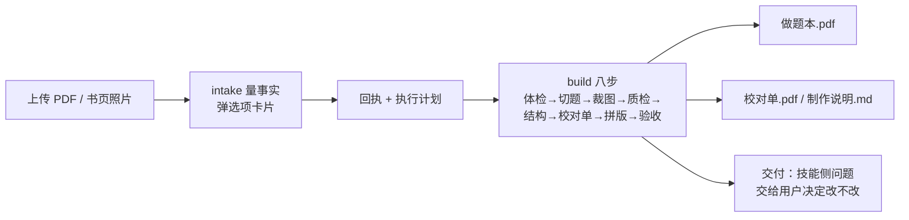

# pdf-to-workbook

把习题册 / 真题集的 PDF（或手机拍的书页）做成**能直接打印手写**的做题本：
每题切下来、下面配答题留白，加页眉、章节页、目录、书签。

成品里的题干**还能搜、能选中复制**：题图上盖了一层不可见文字（`Tr 3`），
屏幕和纸上看到的仍是原书字形，搜「单调有界」能跳到那一页。
原书有文字层就直接读它；纯扫描件跑一遍整页 OCR（约 2–3.5 秒/页）补上。


> 左右都是真实页面，不是示意图。左边原书一页挤了 7 道题，题与题之间没有下笔的地方；
> 右边是同一批题，每道切下来、按题型配好答题区，页眉、章节、页码都是程序画的，
> 每张题图右下角标着「原书 P5」方便对照。

> 这个 README 只用于 GitHub 首页导航。**技能本体在 [`SKILL.md`](SKILL.md)**，
> 人类用户手册在 [`references/user-guide.md`](references/user-guide.md)。

## 安装

一句话：skill 就是「一个目录 + 里面一个 `SKILL.md`」。把整个仓库放进 agent 的技能目录就行。

### 1. 先决定放哪儿

| 范围 | 谁能用 | WorkBuddy / CodeBuddy | DeepSeek Harness（dsh） | Claude Code |
| --- | --- | --- | --- | --- |
| 用户级 | 本机所有项目 | `~/.workbuddy/skills/` | `~/.dsh/skills/`（也认 `~/.agents/skills/`） | `~/.claude/skills/` |
| 项目级 | 只有这个项目 | `<项目>/.workbuddy/skills/` | `<项目>/.dsh/skills/`（也认 `<项目>/.agents/skills/`） | `<项目>/.claude/skills/` |

dsh 会盯着这些目录，放进去即生效，**不用重启**；WorkBuddy 和 Claude Code 重启会话后可见。

### 2. 放进去

挑一行执行（以用户级为例）：

```bash
# WorkBuddy / CodeBuddy
git clone https://github.com/zhuliudan666/pdf-to-workbook.git ~/.workbuddy/skills/pdf-to-workbook

# DeepSeek Harness
git clone https://github.com/zhuliudan666/pdf-to-workbook.git ~/.dsh/skills/pdf-to-workbook

# Claude Code
git clone https://github.com/zhuliudan666/pdf-to-workbook.git ~/.claude/skills/pdf-to-workbook
```

Windows 的命令行里 `~/` 不管用，换成下面这行（把 `.dsh` 改成你要的目录）：

```
git clone https://github.com/zhuliudan666/pdf-to-workbook.git "%USERPROFILE%\.dsh\skills\pdf-to-workbook"
```

**不装 git 也行**：仓库页右上角 `Code → Download ZIP`，解压出一个目录，丢进上表的任一位置。目录名随便改，但层级必须是 `skills/pdf-to-workbook/SKILL.md`——多套一层就认不出来。

### 3. 装依赖（只装一次）

把 `<技能目录>` 换成你在第 1 步选的那个（例如 `~/.workbuddy/skills`）：

```bash
python -m pip install -r <技能目录>/pdf-to-workbook/requirements.txt
```

**用 `python -m pip` 而不是 `pip`**：Windows 上经常同时装着两个 Python，`pip` 和 `python`
不是同一个，装完了 `import` 还是报 `ModuleNotFoundError`。`python -m pip` 保证装进当前这个解释器。

只处理带文本层的 PDF 时，`rapidocr-onnxruntime` 和 `opencv-python` 可以不装（那是扫描件和手机拍照路线要的）。另外需要一个中文字体，见[依赖与字体](#依赖与字体)。

### 4. 验证

```bash
# 文本层路线要的四个：
python -c "import pymupdf, yaml, numpy, PIL; print('文本层路线：依赖齐了')"

# 扫描件 / 手机拍照另外还要这两个（不跑这两条路线可以跳过）：
python -c "import cv2, rapidocr_onnxruntime; print('扫描件路线：依赖齐了')"
```

一条都不报错就说明装好了。报了 `ModuleNotFoundError` 但 pip 说已安装，就是第 3 步那两个
`pip` / `python` 不是同一个——回头用 `python -m pip` 重装。

- **dsh**：输入 `/pdf-to-workbook`，回话说技能已加载就成了
- **WorkBuddy / Claude Code**：直接说「把这本书做成做题本」；加载成功时它回「收到，技能已加载完成…」并请你传文件
- **没出现**：九成是目录多套了一层，检查有没有 `skills/pdf-to-workbook/pdf-to-workbook/SKILL.md` 这种结构

> 本仓库是私有的，克隆前要先登录 GitHub（`gh auth login`，或用 GitHub Desktop 打开一次）。
> 想让别人免登录安装，把仓库可见性改成 public。

### 5. 也可以让 agent 自己装

能。只要那个 agent 能跑命令、能写文件，把下面这段整个丢给它就行——不用你自己敲 shell：

```text
把这个仓库装成你的技能，装完自己验证一遍：
https://github.com/zhuliudan666/pdf-to-workbook

1. 放进你的用户级技能目录（WorkBuddy/CodeBuddy 是 ~/.workbuddy/skills/，
   DeepSeek Harness 是 ~/.dsh/skills/，Claude Code 是 ~/.claude/skills/），
   层级必须是 <技能目录>/pdf-to-workbook/SKILL.md，不要在里面再套一层同名目录
2. 装依赖：pip install -r requirements.txt
3. 自检：python -c "import pymupdf, yaml, numpy, PIL" 不报错就算齐了；再跑
   python scripts/intake.py --help 能打出用法，说明脚本本身也起得来
4. 告我装到哪个路径了、现在能不能用
```

它做完这四步就等于装好了。要是它只 clone 了没装依赖，你补一句「把 requirements.txt 装上」即可。

> 前提是本仓库对它有读权限：私有仓库需要它手上已经有你的 GitHub 凭据
> （桌面端登录过、或 `gh auth login` 过）。都没有的话，把仓库改成 public 最省事。

## 怎么用

一句话：**把 PDF 传给它，说「做成做题本」**。它先量事实、用选项卡片问两三项，
出一份回执给你确认，然后跑八步流水线，最后把成品、校对单和制作说明一起交给你。



### 一次真实的对话

```
你：把 李林四套卷.pdf 做成做题本，我要打印

它：收到，技能已加载完成，接下来把需要制作成做题本的 PDF 传给我就行。
    要是只有拍下来的书页照片，直接发我也可以。我先看看这份文件的版式，
    并提供相关选项供你选择，收集好必要的信息后，便可以正式开始做题本的制作。

你：（上传 李林四套卷.pdf）

它：量完了。16 页、有文本层，目录里认出 4 套合订，已按册分章。
    〔选项卡片〕做哪些页？     全书（默认） / 先跑 3 页 / 指定页段
    〔选项卡片〕每页题数？     标准：选填 4 / 大题 3（默认） / 紧凑 / 宽裕

你：（点「全书」「标准」）

它：回执确认——题号正则命中 88 题，成品约 29 页，A4 单面、纯白留白。确认完就开工。

它：跑完了。做题本 29 页 / 88 题；校对单 9 页，重点 0 条、关注 26 条；
    题数对账 88/88、验收闸 0 项未覆盖，制作说明.md 一起给你。
    这一轮没有需要你拍板的技能侧问题。
```

四个地方值得留意：

1. **只请上传，再点选项卡**。没拿到文件时不会预告会问哪几项，也不让你顺带打字
   交代设置；问题是 `intake.py` 按这份文件的情况生成的，用 `AskUserQuestion` 交成可点的卡。
2. **先出回执再动手**。范围、题量、每页几道、纸张都在回执里；想先试手就点「先跑 3 页」，
   切点对了再放开整本，别一上来等十分钟。
3. **校对单要翻**。每道题的图是切下来的，切歪一两道肉眼能看出来；
   校对单把可疑的按「重点 / 关注 / 抽检」排好，翻一遍就知道要不要重跑。
4. **技能的账由你拍板**。这一轮检测出但没解决的问题（哪道闸没覆盖、某类题号没切全、
   沉淀的预案漏了开关）会列出来，再给一张「另开一轮改 / 不改 / 现在就改」的选项卡，
   它不会自己判断「不用改」就略过，也不会偷偷改完再交付。

### 不想让 agent 代劳

按 `SKILL.md` 开头的「工作流程」手敲。`build.py` 一条就跑完八步（体检→切题→裁图→
质检→结构校验→校对单→拼版→验收），但**它只保证「切得下去」，不保证「没切进内容」**——
所以后面还要补一次自检和诊断：

```bash
pip install -r requirements.txt
cd /path/to/pdf-to-workbook && SKILL="$PWD" && PY=python

# ① 出计划（脚本把问题写进 intake.md 由 agent 交成选项卡片；--say 只承接你已主动说过的原话）
"$PY" "$SKILL/scripts/intake.py" 书.pdf --out 输出目录 --say "用户原话"

# ② 一键全流程
"$PY" "$SKILL/scripts/build.py"  书.pdf 输出目录/intake.yaml 输出目录

# ③ 补一次自检：查「有没有切进内容」，build 兜不住这一层
"$PY" "$SKILL/scripts/selfcheck.py" 书.pdf 输出目录 输出目录/intake.yaml --json 输出目录/selfcheck.json
"$PY" "$SKILL/scripts/diagnose.py" --check 输出目录/selfcheck.json --questions 输出目录/questions.json
```

产物：

| 文件 | 用途 |
| --- | --- |
| `输出目录/做题本.pdf` | 打印用 |
| `输出目录/校对单.pdf` | 五分钟翻一遍：红框必看、黄框快扫、灰框查缺题 |
| `输出目录/联系表.png` | 全部题图的缩略图，一眼看切点齐不齐 |
| `输出目录/qa.csv` | 切点质检表，先按数字找可疑的刀 |
| `输出目录/accept.json` | 七条验收闸的结果，以及 `warnings`（哪几道闸没覆盖到） |
| `输出目录/制作说明.md` | 这次的判断、默认值、没验到的项，随成品一起交付 |
| `输出目录/selfcheck.json` | 第 ③ 步的自检结果，诊断读它 |

`diagnose.py` 说『全干净』才算收工。它报红时按 `SKILL.md` 的「症状 → 参数」表改，
不要凭感觉调阈值。

## 第一本慢，同类的第二本快

**慢的不是跑，是调参。**

跑本身按页数线性耗时：切题、裁图、拼版，扫描件再加 OCR（约 5 秒/页）。OCR 缓存是按书
存的（缓存名带页码），换书不共享——所以第二本该等多久还是等多久，这部分不会变快。

省下来的是**摸配置**：切点压没压准、页眉水印要不要剔、多套合订怎么分章、每页放几道。
这些沉淀在两个地方：

| 机制 | 作用 |
| --- | --- |
| `profiles/` 六套预案 | `classify.py` 认出素材类型就自动套配置，不用逐项调 |
| `tools/learn.py` | 把这次跑通的配置固化成新预案，下次同类书直接命中。**沉淀可选、可回滚，由用户在交付时决定**；判据改动要带 selftest + regress |

前提是**版式同源**——同出版社、同系列、同一批扫描件。第二本往往一次就过；
换一家出版社，题号写法、页眉位置、栏数都变，预案不命中，等于重新来一遍。

所以这套东西的成本随「书型」递减，不随「本数」递减。

> 心理预期：第一次做某一类书，留出一两轮调参的时间（改的是配置，不是代码）；
> 同类第二本开始，多数能一轮到底。`profiles/` 里目前 `handout`（讲义课后题）标着
> `verified: false`，第一次拿真讲义进来要格外看一眼校对单。

## 和纯脚本的区别

切题、裁图、拼版本身都是确定性脚本。这套流程额外做了四件脚本自己不会做的事：

| 环节 | 补了什么 |
| --- | --- |
| 认门 | 目录是图片、卷次交界挤在同一页时，`split_volumes.py` 按卷标题拆页并写好分册；认不出就停，不猜 |
| 验收 | 从原书题型标题推「应有题数」并与实际题数对账——只切出 40 题不会一路绿到交付 |
| 验收 | `accept.json` 的 `warnings` 报告「哪几道闸没查到」，不再拿一句「验收通过」粉饰空跑 |
| 交付 | `制作说明.md` 随成品写清判断、默认、没验到的项；检测出但没解决的问题列给用户，改不改 skill 由用户选，不替他决定 |

刻意没往里加生成式能力：矢量重排那条路已经证明「让模型逐题转写」会带来
「识别错了却看起来完全正常」的失败。这里的改进是让脚本能报告自己的盲区。

还有一条底线：**不穷举预案**。skill 是可进化的工作台，不是要把所有版式都装进去的手册；
认不出就如实报「未覆盖」，由 agent 读懂这一本、临时补配置，再决定值不值得沉淀。

完整的机制、判据和取舍见 **[工作原理](HOW-IT-WORKS.md)**：一份 PDF 怎么变成做题本、
切点怎么定、OCR 到底用在哪、留白怎么分、七条验收闸各抓什么。

## 适合什么素材

| 素材 | 怎么描述它 | 实测成品 |
| --- | --- | --- |
| 整本练习册 / 题库 | 一题一号，全书都是题 | 106 页 → 720 题 / 220 页 |
| 套卷 / 真题合订 | 一张卷子二十来道，按「一、选择题」「二、填空题」分段；多套合订会按册自动分章 | 16 页 / 4 套 → 88 题 / 29 页 |
| 单章 / 单讲节选 | 一本厚书里只要第 18 讲 | 5 页 → 15 题 |
| 讲义章末课后题 | 正文占九成，题只在每章最后一页 | 45 页 → 173 题 / 70 页 |
| 讲义里的例题 | 「例 1.2」后面紧跟「解：」或「【详解】」 | 69 例 / 6 章 |
| 手机拍的书页 | 一页一张照片 | 逐页给题号，直接出 PDF |

**做不了**：双栏排版（会把两栏当一行，36 题只认出 18 道）、没有题号的素材、加密 PDF。

> 页眉印着「公众号：xxx」这类引流行不碍事，会被剔掉，不会印进题图。

## 目录

| 路径 | 是什么 |
| --- | --- |
| `HOW-IT-WORKS.md` | 工作原理：位图裁切的核心决策、八道工序、切点判据、OCR 的定位与检索用途、留白算法、验收闸、体积与实测数字 |
| `SKILL.md` | 技能本体。前面是工作流程，`# 以下给维护者` 之后是判据与设计取舍 |
| `references/user-guide.md` | 用户手册：三步命令、能不能做、档位、qa.csv 怎么读、症状表 |
| `references/transcribe-prompt.md` | 矢量重排路线的转写提示词 |
| `references/example-items.json` | 矢量重排的输入格式样例（4 道题，含 `uncertain` 字段怎么写） |
| `scripts/` | 流水线：intake → probe → 切题 → 裁图 → 质检 → 校对单 → 拼版 → 验收；另有 `split_volumes.py`（合订卷拆页）、`expect.py`（期望题数）、`report.py`（生成制作说明）、`vector_plan.py`（矢量转写模板） |
| `profiles/` | 6 类素材预案，命中后自动套配置 |
| `tools/` | 沉淀预案（learn）、清理中途产物（clean）、PDF 转图（render_preview） |
| `assets/preview.png` | README 顶部那张成品图 |
| `config.yaml` | 全部可调参数 |

> `tools/learn.py` 的「试档」功能要读 `tools/regress/` 里的回归基线，那目录存着真书的切点坐标，
> 没有随发布版提供。缺基线时它只写配置、不做试档，不会报错。

## 依赖与字体

见 `requirements.txt`。另外需要**一个中文字体**（页眉、章节标题、目录是我们自己画的字）：
Windows 自带微软雅黑、macOS 自带苹方、Linux 装 `fonts-noto-cjk`。
一条都找不到时会明确警告，不会静默出一份没有标题的成品。

## 已知限制

- 双栏排版不支持，体检阶段会拦下
- 文本层路线没有「页首章节标题不归第一题」这道闸（详见 `SKILL.md` 的「已知限制」）
- 扫描件整本 OCR 约 5 秒/页，有缓存，重跑只处理新增页

## 许可

[MIT](LICENSE)。自己做的书自己用，出问题别找我。
